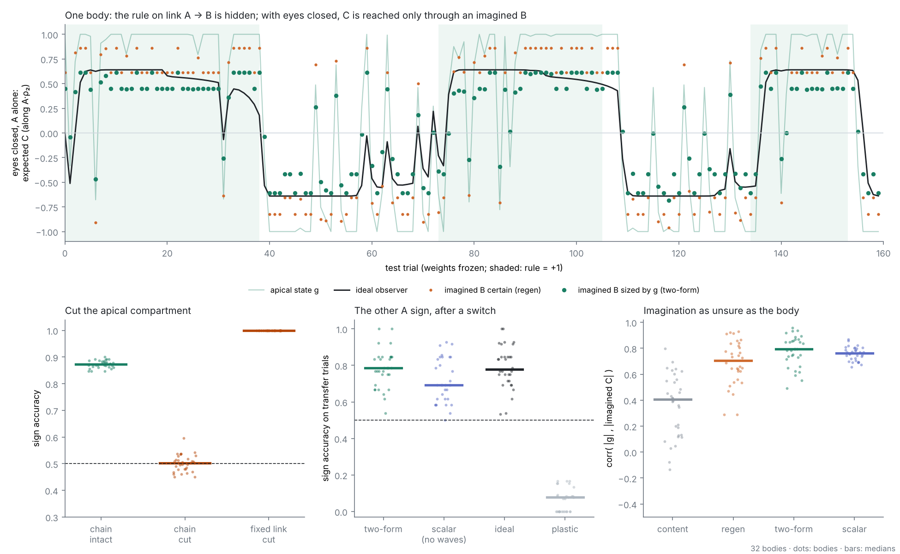

# WaveCortex

**The fusion of three wave machines into one cortex-shaped body.** A hidden rule governs the first link of a chain A → B → C. With its weights frozen and its eyes closed, the body still reaches C through an imagined B, under whichever rule it currently believes in. That imagined B is about as unsure as the body is. Cutting the apical compartment separates the two links: the gated link falls to chance and the fixed link stays perfect. All six rules set before the run held. As in every repo of this line, a no-wave scalar copy of the same algorithm is more accurate: the waves carry the computation, they don't improve it.

Antti Luode's direction · Claude Opus 5.5, design, code and write-up · 17 November 2026.

[Protocol, committed before the batch](PROTOCOL.md) · [engine](cortex/cortex.py) · [world and baselines](experiments/world.py) · [receipt](experiments/results.json) · [summary](experiments/summary.json)



## What is fused

| From | What it brings | What it showed alone |
|---|---|---|
| [WaveComputer](https://github.com/anttiluode/WaveComputer) | the A → B → C wave body: two fields, residual learning, latched fade clocks, and the **two-form** B unit, whose imagined B runs on a regenerated clock with a size set by the unit's own apical fade | imagination as sure as the body's own links (0.97–1.02) |
| [ApicalRuleReversalMachine](https://github.com/anttiluode/ApicalRuleReversalMachine) | the **multiplying apical gate**: every branch writes pulse · (W + g·V), with a shared state g driven by surprise; slow weights, fast state | an uncued rule inferred from surprise; the mouse-style cut |
| [WaveComputerAstra](https://github.com/anttiluode/WaveComputerAstra) | the discipline: a **scalar baseline** beside every wave result, and **causal cuts** | two-hop relays, faithful only with supplied addresses and clocks |

In the engine nothing is new except that these meet: g gates the A → B branches. So the imagined B — and through it C — carries the body's belief about a rule it was never told. With the gate off, `tests/test_engine.py` checks that it reproduces WaveComputer's verified machine exactly, in training and in all three eyes-closed kinds. That machine is itself retrained against 48 published QualiaClaude bodies to 1e-7.

## The world

- A = ±1;
- B = **rule** · A (90% reliable), where the rule flips without a cue after 20–40 trials;
- C = ρ₂ · B (90% reliable), a **fixed** link.

The body trains with eyes open for 1500 trials, then is tested for 400 trials with **weights frozen**: only g moves.

Every test trial is first **read** with eyes closed, A alone, then lived with A, B and C. The exact answer for the eyes-closed C is

```math
E[C] \;=\; (2Q_2-1)\,(2Q_1-1)\,\big(2\,P(\text{rule}=+1)-1\big) \quad\text{along } A\rho_2 .
```

## Results

32 bodies, seeds 500001–500032. Medians.

| Rule set beforehand | Required | Measured | |
|---|---|---|---|
| **P1** learning sorts the links: A → B into the gated weight V, B → C into the basal W | ≥ 29/32 | **32/32** | pass |
| **P2** eyes closed, the imagined chain follows the hidden rule | ≥ 0.80 | **0.87** (ideal 0.94) | pass |
| **P3** transfer: the other A sign, after a switch | ≥ 0.65; plastic ≤ 0.25; above plastic ≥ 29/32 | **0.79** (ideal 0.78); plastic **0.08**; **32/32** | pass |
| **P4** cut: the gated chain falls to chance, the fixed link with a real B stays right | 0.35–0.65 and ≥ 0.95 | **0.50** and **1.00** | pass |
| **P5** imagination as unsure as the body: corr(\|g\|, \|imagined C\|) | ≥ 0.70 | **0.79** | pass |
| **P6** closer to the ideal than relay content and than the plastic learner | each ≥ 29/32 | error 0.091 vs 0.150 and 0.234; **29/32**, **32/32** | pass |

**Reported without a rule:**

| Eyes closed, A alone → C | accuracy | error vs ideal | follows own belief | slope vs ideal | transfer |
|---|---:|---:|---:|---:|---:|
| ideal observer | 0.94 | 0 | — | 1.00 | 0.78 |
| **two-form** (imagined B sized by g) | 0.87 | 0.091 | **0.79** | 0.64 | 0.79 |
| regen (imagined B certain) | 0.87 | 0.122 | 0.71 | 0.95 | 0.79 |
| content (relay) | 0.86 | 0.150 | 0.41 | 0.59 | 0.70 |
| scalar copy, no waves | 0.89 | **0.049** | 0.76 | 0.86 | 0.69 |
| apical cut | 0.50 | 0.335 | — | 0.00 | 0.50 |

- **Two-form against regen:** better in **22/32** bodies on error, and **23/32** on following its own belief. I predicted about two thirds. It is a modest edge. In this world regen's threshold already silences a weak imagined B, so regen is graded too, but all or nothing.
- **Two-form runs low.** Its slope against the ideal is 0.64, while regen's is 0.95. Regen's level is right for the same reason as in WaveComputer: errors cancel. It sends a certain B through a B → C link that was learned too weakly. Two-form sends a B as unsure as the belief, through the same weak link, so the shortfall shows.
- **The body is overconfident near block ends.** The ideal observer knows that blocks last 20–40 trials, so it grows unsure as a block ages. It shrinks its prediction to 0.75 of its sure size on unsure trials; two-form shrinks only to 0.95. A body that only feels surprise cannot know a block's age.
- **The scalar copy is closer to the ideal in 32/32 bodies.**

## What it shows

1. **A belief about a hidden rule can travel through an imagined event.** With frozen weights and no B in sight, the body's C follows the rule it has inferred (0.87). For the other A sign right after a switch it is as good as the ideal observer (0.79 against 0.78), because both A signs share one apical state. A per-sign learner gets 0.08.
2. **The cut separates gated from fixed, inside one chain.** Silencing g kills the imagined chain (0.50) and leaves the fixed B → C link untouched (1.00). That is the mouse result of Zhang et al., moved one step down a chain.
3. **Learning finds which link is gated.** In all 32 bodies, the rule-dependent A → B link went into the gated weight and the fixed B → C link into the basal one. Nothing told it which was which.
4. **The size of imagination follows the body's own belief, but its level does not reach the ideal.** This is the same pattern WaveComputer found: imagination is faithful to the body, and the body's learned links are weak.
5. **The waves are the carrier, not the computer.** This holds across all four repos of the line: the arithmetic is the multiplication pulse · (W + g·V), the three-factor rule and the normalized surprise step. Moved into waves, it gets slower and less accurate.

## Ledger

**Shown:** P1–P6, pre-registered, in one batch of 32 bodies.

**Inherited, not tuned:** every constant comes from WaveComputer and ApicalRuleReversalMachine:
- units, wave physics and the regeneration threshold;
- the learning rate of 0.006;
- η = 0.5 and κ = 0.05.

The development bodies (981–986) changed nothing.

**Supplied, not learned:**
- event sites and timing;
- one shared apical state, starting at +1;
- the regenerated seen-B shape;
- each clock's calibration;
- the body gain G.

**Not shown:**
- calibration at the ideal's level (slope 0.64);
- knowledge of block age;
- two imagined hops (Astra shows that needs addresses);
- more than one rule;
- any advantage of the wave medium.

**Known parts:**
- adaptive cancellers;
- three-factor plasticity;
- normalized LMS;
- context-dependent gating;
- hidden-state filtering;
- apical amplification and drive (Larkum; Marvan & Phillips 2024);
- dendritic rule coding (Zhang et al. 2025, preprint).

**Ours:**
- their combination in fade-clock units on an impulse-response wave field, under local rules;
- the gated-chain test with its double dissociation;
- the measurement that a sized imagination follows the body's belief better than a certain one, modestly.

## Run

```sh
python -m pip install numpy matplotlib
python tests/test_engine.py       # with the gate off, identical to WaveComputer's verified machine
python experiments/dev.py         # 6 development bodies (3 minutes)
python experiments/run.py         # the batch, 32 bodies (16 minutes on two cores)
python experiments/analyze.py     # summary.json against PROTOCOL.md
python experiments/figure.py
```

## Sources

- [WaveComputer](https://github.com/anttiluode/WaveComputer), [ApicalRuleReversalMachine](https://github.com/anttiluode/ApicalRuleReversalMachine), [WaveComputerAstra](https://github.com/anttiluode/WaveComputerAstra); before them [QualiaClaude](https://github.com/anttiluode/QualiaClaude), [QualiaAstra](https://github.com/anttiluode/QualiaAstra), [QualeX](https://github.com/anttiluode/QualeX). The vendored PerceptionLab nodes are in [`vendor/`](vendor/).
- Y. Zhang et al., "Dendritic computation for rule-based flexible categorization", bioRxiv (2025), doi:10.1101/2025.06.03.657766. A preprint.
- T. Marvan and W. A. Phillips, *Current Research in Neurobiology* 6 (2024) 100129.

MIT licence.
